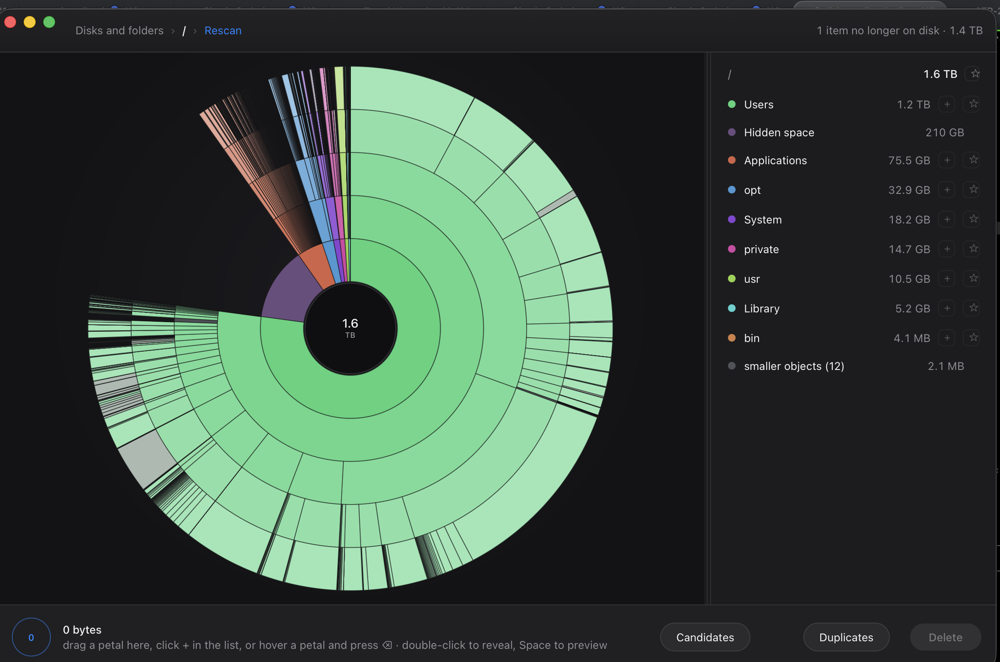

# DiskGuardian

**See what is actually filling your disk, and get the space back.**

DiskGuardian draws a volume as an interactive sunburst: every folder a coloured petal,
sized by the space it really occupies on disk. Drill into the big ones, drag what you do
not need into the collector, and delete it. Open source, written in Rust, macOS-first and
built to run anywhere the scanning engine runs.

<p align="center">
  
</p>

<p align="center">
  <em>One glance: 1.2 TB is in Users, and 210 GB is space no scanner could see. One drag:
  it is in the collector.</em>
</p>

## Why another disk cleaner

Finder's storage view tells you a category ("System Data"). DiskGuardian shows you *the
actual folder*, at its actual size, in one picture. There are no presets and no automatic
deletion: you look, you decide, you delete.

## What it does

- **A sunburst, not a list.** Petal width is space. Coloured petals are folders, grey are
  files, purple is space it could not read, struck-through items vanished since the scan.
- **Drill in and out.** Click a petal to enter it, click the centre to leave.
- **Hover for detail.** The right-hand column shows the current level, biggest first.
- **Collect before you delete.** Drag petals to the collector, watch the total climb, then
  delete once. A guard refuses system locations and asks before anything big.
- **Honest numbers.** Sizes are physical allocation (`st_blocks * 512`), not file length.
  Hard links are counted once. Space it cannot read is shown as restricted, never as zero.
- **Quick Look.** Press Space on any item for the system's own preview.

## Install

Builds a macOS app bundle from source:

```bash
bun install --cwd apps/desktop
bun run --cwd apps/desktop tauri:build
# → target/release/bundle/macos/DiskGuardian.app  (workspace root target/)
```

`tauri:build` first stages the `diskguardian-admin` measurement helper for the
bundler (Tauri's `externalBin` wants it prebuilt, target-triple-suffixed, under
`src-tauri/binaries/`). If you only want `cargo build`/`test`/`clippy` on the whole
workspace, run `bun run --cwd apps/desktop stage:admin` once first: the app crate's
build script fails until the staged helper exists.

Requires Rust (stable), Bun, and the Xcode command line tools.

## Development

```bash
cargo test -p diskguardian-core     # scan engine: sizes, links, permissions, guards
cd apps/desktop && bun test          # sunburst layout maths
cd apps/desktop && bun run tauri:dev # the app, hot-reloading
```

The frontend also runs in a plain browser (`bun run dev`) against a synthetic tree, which
is useful for layout work.

## Architecture

```
crates/core/          pure Rust, no UI: the scanning engine
  scan.rs             parallel walk, physical-size accounting, hard-link dedupe
  model.rs            the tree: own_bytes / total_bytes and the invariant between them
  view.rs             pruning for display: big children kept, long tail merged
  collect.rs          the collector, with overlap counted once
  delete.rs           guarded deletion; Trash by default, permanent on request
crates/admin/         diskguardian-admin: one-shot read-only helper behind the
                     administrator dialog (job file in, results file out; measures,
                     never deletes)
apps/desktop/
  src-tauri/          the Tauri shell: IPC commands, Finder reveal, Quick Look
  src/                the sunburst: layout maths, canvas renderer, interaction
```

The engine is deliberately UI-free so a CLI, a Windows build, or a test harness can reuse
it unchanged.

## Safety

Deletion is the only destructive thing here, so it is the most constrained:

- The backend deletes only paths that came from a scan it holds in memory.
- System trees (`/System`, `/usr/bin`, `/bin`, `/sbin`, `/private/etc`, …) are refused.
- The scanned root itself is refused.
- The default is the macOS Trash: you can change your mind until it is emptied.
- Deleting more than 5 GB requires explicit confirmation.

## Administrator measurement

Some areas (other users' homes, most of `/Library`, parts of `/private/var`) cannot be
read with your own permissions, and DiskGuardian draws them as purple "restricted"
petals rather than pretending they are empty. After such a scan, the status bar offers
**Measure restricted areas…** — the first pass raises one system password dialog, and
those petals are re-measured and redrawn at their real sizes.

What that pass is, plainly:

- **The dialog belongs to macOS.** The app never sees, holds, or caches your password.
  There is **one prompt per app session**: approving it starts a small measurement
  helper that serves every later pass without asking again. The helper lives exactly
  as long as the app does — it exits when the app exits (its working directory goes
  away), when the app's heartbeat stops (a crash), or after 15 idle minutes — and no
  privileged process exists between app runs.
- **The privileged side measures; it never deletes.** The helper walks the restricted
  paths read-only and writes the numbers back. It contains no deletion code at all,
  and deletion continues to run unprivileged, behind the same guard as always. Seeing
  a protected folder is never the same as being able to delete it.
- **You may still have purple petals afterwards.** Root does not bypass macOS privacy
  controls (TCC), so folders like `~/Library/Mail` may stay restricted until DiskGuardian
  is granted Full Disk Access. Whatever could not be measured is reported with a count,
  never silently dropped.

## Hidden space

A scan of a **volume** (its root is a mount point — the startup disk, an external disk)
does not stop at the flower. The volume's own used space is measured fresh at every
view, and the gap between that figure and everything the scan could see is drawn as one
**Hidden space** petal — its width is always exactly `volume used − scanned tree` at
the moment you are looking at it, so deleting files grows it in the same frame, with no
rescan.

Click the petal and the panel says what the figure is, and what it is not:

- **The hidden figure is measured.** It is the volume's used space (statfs — the figure
  `df` prints) minus the scanned tree. If the tree ever totals *more* than the volume
  reports used — the disk changed during or after the scan — the petal is omitted and
  the panel says so in words, never a silent zero.
- **The breakdown is held.** The gap could in principle be split into other volumes of
  the same APFS container, local snapshots, protected areas, and a still-hidden
  remainder. That split is **not shown**: the acceptance rule that was written before
  any measurement could not confirm it on a second volume, so no category is presented
  at all — an unshown category can never be mistaken for an empty one. The measuring
  code is kept and tested in the app's volume module, waiting on that cross-check.
- **Purgeable space is an annotation, not a slice.** macOS also reports how much it
  *may* free on its own (snapshots, caches, offloaded content). That pool overlaps
  space the scan already counts, so it is shown beside the figure as "up to N" — never
  as part of the hidden figure, and nothing in this app offers to purge it. The only
  purges are the ones you ask for yourself: your snapshots (as you, not elevated) and
  your Trash.

A volume scan also stays on its own disk: it walks only the scanned volume's device
(the startup volume's System and Data volumes count as one, because macOS presents them
as one), never enters other disks or transient snapshot mounts, and lists the mounts it
excluded.

## Favourite folders

Any folder you keep coming back to can be starred, and the favourites then sit at the
top of the "Disks and folders" page — above home, Trash, snapshots and every volume —
each with a Scan button and a star to remove it again.

- **Star from the scan screen.** The contents list on the right carries a star beside
  the `+` on every folder row, and the list's heading has one for the folder you are
  currently inside. Starring never navigates.
- **Unstar from the front page.** The ★ beside a favourite removes it. Unstarring
  removes a list entry, never a file.
- **Where the list lives.** A `favourites.json` file in the app's own data directory
  (`~/Library/Application Support/com.madeinoz.diskguardian/` on macOS), written
  atomically by the app itself. The webview never writes favourite state, so a webview
  bug cannot corrupt the list; and if the file ever is unreadable, it is kept beside a
  fresh one and the page says so rather than reading as "no favourites".
- **"Not on this disk right now."** A favourite whose folder has been deleted, or whose
  volume is not mounted, stays on the page with that sentence as its detail line and
  its Scan disabled — reported, never silently dropped. It re-enables itself the moment
  the folder exists again; until then, unstarring is the way to clear it.
- **One folder, one row.** Starring a folder that is already a favourite — including
  through the other spelling of a symlinked path — is a no-op. Favourite rows show no
  size, because a size would mean walking every favourite on every page load.

## Status

Early. The core loop works end to end on macOS: scan, draw, drill, collect, delete, and
administrator measurement of restricted areas.

Not yet: cloud accounts (Dropbox, Drive, OneDrive, Box), APFS local
snapshots, disk images, network volumes, and Windows/Linux builds.

## Licence

MIT.
